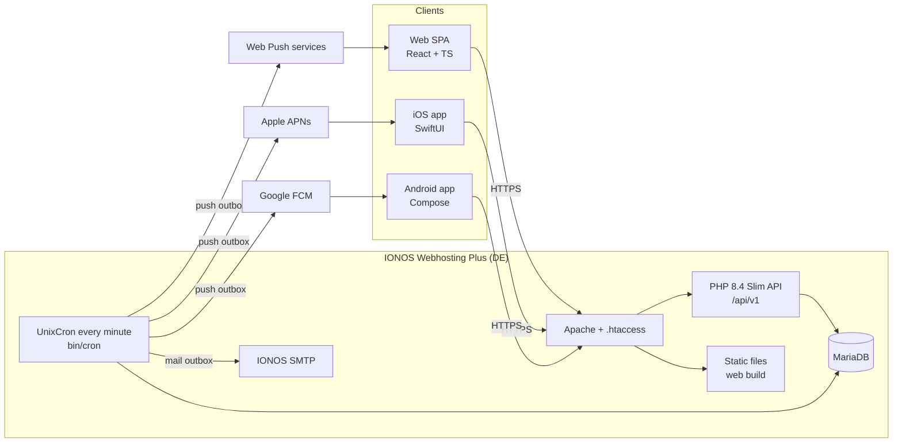
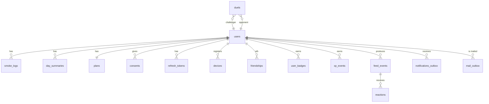
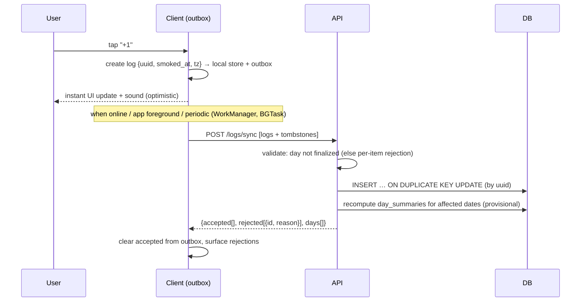
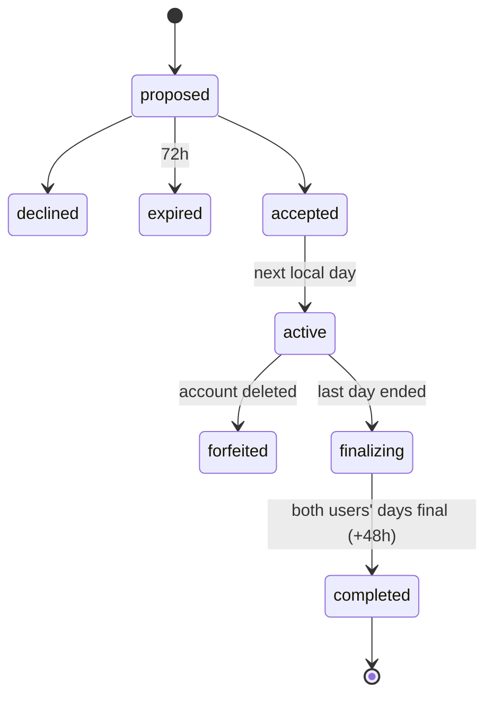

# High-Level Design (HLD)

**Project:** Smoke Detector
**Status:** Draft v0.1 — 2026-11-17 — for review
**Implements:** [SRS.md](SRS.md)

---

## 1. Architecture decisions (summary)

| # | Decision | Options considered | **Chosen** | Why |
|---|---|---|---|---|
| AD-1 | Backend runtime | PHP/Slim · PHP/Laravel · Node on VPS · BaaS (Firebase/Supabase) | **PHP 8.4 + Slim 4** | Runs natively on IONOS Webhosting Plus, which most likely can't keep a Node process alive. Small, explicit and easy to unit test. |
| AD-2 | Database | MariaDB/MySQL (IONOS) · SQLite | **MariaDB 11.8 from the IONOS package** (verified) | Included, managed and backed up. Concurrent writes from many users. Reachable only from the webspace. |
| AD-3 | Client strategy | 3 native thin clients · KMP · PWA-first · Flutter/RN | **TS web + SwiftUI + Jetpack Compose, all thin** | **All game rules run on the server**, so business logic is written and tested once, in PHP. Clients only render and queue logs. |
| AD-4 | API contract | Code-first · **Contract-first OpenAPI 3.0.3** | **Contract-first** (3.0.3 rather than 3.1, because the PHP validator and all three client generators support it fully) | One `openapi.yaml` generates typed clients for TS, Swift and Kotlin. The backend validates against it in tests (contract tests). |
| AD-5 | Auth | Email+pw · +Apple/Google · Magic link | **Email + password, JWT access (15 min) + rotating opaque refresh token. Email must be confirmed before first use** | Self-hosted, no third parties. Refresh tokens are stored hashed, so they can be revoked. Confirm-first means sign-up never reveals who has an account. Details in §4.5. |
| AD-6 | Offline | Offline-first · online-only | **Offline-first logging via client outbox + idempotent batch sync** | NFR-03 zero log loss. Users log outdoors. |
| AD-7 | Realtime | WebSockets · SSE · **polling + push** | **Push notifications + refresh on app foreground / pull-to-refresh** | Shared hosting allows no long-lived connections (C-1). |
| AD-8 | Background work | Queue worker · **cron** | **IONOS UnixCron → executable wrapper `bin/cron` every minute** (URL+secret fallback) | The only background mechanism available, and the web PHP cannot work after its response (§8). Every minute because confirmation and reset mails are sent by this job. Jobs are idempotent. |
| AD-9 | Hosting topology | API subdomain · **same origin** | **Same origin: `/` = web SPA, `/api/v1` = PHP** | No CORS, and the web refresh token can live in an httpOnly SameSite=Strict cookie. |
| AD-10 | Web framework | React · Vue · Svelte | **React 18 + Vite + TypeScript** (overridable) | Largest ecosystem for testing (Vitest, Testing Library, Playwright, MSW). |
| AD-11 | Repo & CI | **GitHub monorepo + Actions** · GitLab · manual | **GitHub monorepo** | One PR can change contract + backend + clients. macOS runners for iOS. |
| AD-12 | Delivery order | **Web → iOS → Android** | as chosen | The web client exercises the API quickly. Native clients follow against a stable contract. |

---

## 2. System context



---

## 3. Repository layout (monorepo)

```
smoke-detector/
├── api/openapi.yaml            # single source of truth for the HTTP contract
├── backend/                    # PHP 8.4, Slim 4
│   ├── public/index.php        # front controller (document root on IONOS)
│   ├── public/.htaccess        # comes with the first deployment
│   ├── src/Domain/             # pure PHP: scoring, streaks, XP, plan, duels — NO I/O
│   ├── src/Application/        # use cases (LogSmoke, CheckIn, CreateDuel, FinalizeDays…)
│   ├── src/Infrastructure/     # PDO repositories, mailer, push senders, clock
│   ├── src/Http/               # Slim actions, middleware, request/response mapping
│   ├── src/Console/            # CLI commands: migrate, mail:send, housekeeping:purge, cron:run
│   ├── templates/mail/{de,en}/ # mail texts
│   ├── config/rules/v1.php     # rule table: every tunable number (SRS App. A). One file per version, never edited once released
│   ├── migrations/             # Phinx migrations
│   ├── bin/console             # CLI entry point for the commands above
│   ├── bin/cron                # executable wrapper the hosting's cron calls (runs cron:run)
│   └── tests/{Unit,Integration,Support}/   # the contract is checked inside the Integration HTTP tests
├── web/                        # React + Vite + TS
├── ios/                        # Xcode project, SwiftUI
├── android/                    # Gradle, Compose
├── shared/assets/              # sounds, animations (Lottie/Rive), badge art, i18n strings source
├── docs/                       # SRS, HLD, ADRs
└── .github/workflows/
```

---

## 4. Backend design

### 4.1 Layers
- **Domain** (pure, deterministic and fully unit-tested, no I/O and no clock). Built in step 2:
  - `Rules\RuleSet`: one immutable object with a version and every tunable number, built from
    `config/rules/<version>.php` by `RuleSet::fromArray()`. Every key is required and unknown keys are
    rejected, so nothing falls back to a hidden default.
  - `Plan`: `Baseline` (tenths of a session, integer), `BaselineCalculator` (weekly update),
    `ReductionPlan::dailyLimit`, `Goal`, `TaperSpeed`.
  - `Day`: `DayOutcome` (count, limit, checked in), `DayFinalizer` (one user-day → new streak state, XP
    awards, level change and celebration events).
  - `Streak`: `StreakCalculator` (both streaks + freezes as a state machine that emits events; a freeze
    covers the check-in streak only).
  - `Xp` / `Level`: `XpCalculator` (the whole Appendix A table), `LevelCalculator`.
  - `Competition`: `FrozenBaseline`, `Reduction` (an exact fraction), `CompetitionScoreCalculator`,
    `CompetitionScoreComparator` (the FR-COMP-03 order).
  - Still to come: `DuelJudge`, `LeagueRanker` (step 5), `BadgeEvaluator`, `HealthMilestones` (step 6).
  - Every rule number and every input has a documented upper bound (constants next to the code, far
    above any realistic value), so extreme input ends in a clear `InvalidArgumentException`, never in an
    integer overflow or an out-of-memory crash.
  - Rounding-sensitive maths uses integers only. Time comes in as a `LocalDate` or through an injected
    `Clock`, never `new DateTime()` inside the domain.
- **Application**: one class per use case. It orchestrates repositories and domain objects and owns the
  transaction boundaries.
- **Infrastructure**: PDO repositories (among them `PdoMailOutbox`), `SymfonyMailer` (SMTP),
  `SodiumMailValuesCipher` (libsodium), `FileCronHeartbeat`, `ApnsSender`, `FcmSender`, `WebPushSender` and
  `SystemClock`, each behind an interface with fakes for tests.
- **HTTP**: Slim actions translate JSON ↔ commands. Errors use RFC 9457 `application/problem+json`.

### 4.2 Key libraries (all pure PHP, installed via Composer in CI, `vendor/` uploaded)
`slim/slim` 4, `php-di/php-di`, `robmorgan/phinx`, `firebase/php-jwt`, `symfony/mailer`,
`minishlink/web-push`, `league/openapi-psr7-validator` (tests), `phpunit/phpunit` 12,
`phpstan/phpstan` (max level), `infection/infection` (mutation testing). A code style checker is not set up yet.

### 4.3 Data model (core tables)



| Table | Key columns / notes |
|---|---|
| `users` | id (UUIDv7, native `UUID` column), email (unique, lower-cased), password_hash, display_name, avatar_key, locale, timezone, email_verified_at (NULL = registration not confirmed yet), token_version (raised by a password reset; an access token is accepted only with the account's current number), created_at (for an unconfirmed registration: when its newest confirmation link was mailed) |
| `consents` | user_id, type (age18, art9, privacy), version, granted_at. Primary key (user_id, type, version) |
| `plans` | user_id (one row per user), goal_mode, target, taper_speed, default_product, start_date, rules_version (the version at onboarding) |
| `baseline_history` | user_id, valid_from (local date), value DECIMAL(4,1), source (onboarding/weekly/unchanged_low_data/capped), w_mean, m_mean, w_days, m_days (all four NULL for the onboarding entry), rules_version. Primary key (user_id, valid_from). Append-only, never recalculated. The current baseline is the entry with the latest valid_from |
| `smoke_logs` | **id = client UUID** (idempotency), user_id, smoked_at (UTC), local_date (worked out by the server, §4.6), product_type (enum: cigarette, rolled, cigar, pipe, shisha, vape, heated_tobacco, other), count (1–50), created_at (when the server first stored the log; never changes), updated_at, deleted_at (tombstone: a deleted log stays stored and stays deleted). Index (user_id, local_date). A log never changes its owner |
| `day_summaries` | user_id, local_date (primary key together), count (the sum of the day's logs that are not deleted, kept in step by every sync), checked_in_at, and what finalization writes, NULL before it: daily_limit, xp, events (the celebration events as JSON text), freeze_used, finalized_at, rules_version. A day is final when finalized_at is set (there is no status column that could contradict it). A row exists from the first log or check-in of the day; finalization creates the rows of days nobody touched |
| `user_progress` | user_id (one row per user, created with the plan): check_in_current, check_in_longest, under_limit_current, under_limit_longest, freezes_held, xp_total, level, next_day (the next local date to finalize: every earlier day is final), finalize_due_at and baseline_due_at (UTC instants the cron job looks for, each with an index). Replaces the `streaks` table of the first draft: the domain's `UserProgress` is one value |
| `plan_history` | user_id, valid_from (local date), goal_mode, target, taper_speed, rules_version. Primary key (user_id, valid_from). Starts with the onboarding. An entry that is in force is never changed; a second change on the same day replaces the entry for tomorrow. `plans` keeps what the user chose last |
| `timezone_history` | user_id, valid_from (local date), timezone. Primary key (user_id, valid_from). Starts with the onboarding, and is replaced in the same way. `users.timezone` keeps what the user chose last |
| `xp_events` | id (UUIDv7), user_id, local_date, source (the domain's `XpSource`), amount, detail (the streak length of a milestone; NULL otherwise), created_at. Append-only ledger, written at finalization; `user_progress.xp_total` is its sum, kept for speed and checked by a test. Index (user_id, local_date) |
| `friendships` | user_a < user_b, status (pending/accepted/blocked), requested_by |
| `duels` | id, challenger_id, opponent_id, period_days, start_date, status, winner_id, result_json (per user: frozen B₀, exact actual/expected totals in tenths, smoke-free days, check-ins, rules_version) |
| `league_results` | period_type, period_key (e.g. 2026-W47), user_id, b0_tenths, actual_tenths, expected_tenths (exact totals, not a rounded percentage), rank, final, rules_version |
| `user_badges` | user_id, badge_key, awarded_at |
| `feed_events` / `reactions` | event type + payload (no raw counts) / reaction_key, from_user |
| `devices` | user_id, platform (ios/android/web), push_token / web-push subscription, locale |
| `notifications_outbox` | user_id, type, payload, not_before, sent_at, attempts |
| `mail_outbox` | id (UUIDv7), user_id (`ON DELETE CASCADE`), template (confirm_email / already_registered / reset_password), locale, recipient, sealed_values (the links of the mail, encrypted with `sodium_crypto_secretbox`: random nonce per row, key derived from `jwt.secret` by HKDF-SHA256 with its own label), created_at, not_before (the next try, or the end of a run's 10-minute hold), attempts (failed tries). A row is deleted as soon as the mail server has the mail. Deliberately no index on not_before (two runs could deadlock on it) |
| `refresh_tokens` | id (the session: one row per login/device), user_id, key_hash and token_hash (SHA-256 of the session key and of the current token), device_label, created_at, generation (0 at login, +1 per refresh; a token's secret is derived from the session key and this number), rotated_at, expires_at, revoked_at. At most 20 live (not revoked) sessions per user; revoked rows are deleted by the cleanup |
| `one_time_tokens` | id, user_id, purpose (verify_email / reset_password), token_hash (SHA-256), expires_at, used_at, failed_attempts (wrong passwords entered with a confirmation link; the fifth deletes the token). Unique (user_id, purpose): a new token replaces the old one in one statement |
| `rate_limits` | key (rule name + keyed hash of the email, user id or client address; for a rule about a pair: rule name + hash of the client + hash of the email, the email last), window_start, hits. The hash is HMAC-SHA256 with a key derived from `jwt.secret` by HKDF-SHA256 with its own label, so the table alone does not tell whether a given address is in it. A key is still treated as personal data: rows are deleted with the account and after 2 days |

### 4.4 API overview (`/api/v1`, full detail in `api/openapi.yaml`)
| Area | Endpoints |
|---|---|
| Auth | `POST /auth/register`, `/auth/verify-email`, `/auth/resend-verification`, `/auth/login`, `/auth/refresh`, `/auth/logout`, `/auth/password-reset/{request,confirm}` |
| Legal | `GET /legal/consents` (public: the versions of the consent texts in force) |
| Me | `GET/PATCH /me`, `PUT /me/plan`, `GET /me/export`, `DELETE /me`. `GET /me/baseline-history` comes with the weekly update in step 4 |
| Logging | `POST /logs/sync` (batch upsert + tombstones → returns affected day summaries), `POST /days/{date}/check-in`, `GET /days?from&to` |
| Progress | `GET /me/dashboard` (today, limit, streaks, XP, level, next milestone), `GET /me/badges` |
| Friends | `GET /friends`, `POST /friends/requests` (by invite code), `POST /friends/requests/{id}/{accept,decline}`, `DELETE /friends/{id}`, `POST /friends/{id}/block` |
| Competition | `POST /duels`, `POST /duels/{id}/{accept,decline,cancel}`, `GET /duels`, `GET /duels/{id}`, `GET /leagues/{type}/{periodKey}`, `GET /leagues/xp/current` |
| Social | `GET /feed`, `POST /feed/{id}/reactions`, `POST /friends/{id}/nudge` |
| Devices | `PUT /devices/{id}` (push token), `DELETE /devices/{id}`, `GET/PUT /me/notification-settings` |

### 4.5 Auth & account design (step 3)

**Stack:** Slim 4, PHP-DI, `nyholm/psr7`, PDO (no ORM), Phinx migrations, `firebase/php-jwt`, `symfony/mailer`,
`symfony/uid` (UUIDv7), `psr/clock`. Tests: `league/openapi-psr7-validator` for contract tests.

**Layers:** `Http` actions only translate JSON ↔ commands and results. `Application` has one class per use
case and owns the transaction. `Infrastructure` has the PDO repositories, mailer, clock, token and password
services, each behind an interface with an in-memory or fake version for tests.

**Registration (confirm first, FR-ACC-01/02/03):**
1. `POST /auth/register` validates the input and the three consents, each sent as `{accepted: true, version}`
   with the version of the text the app showed. A version other than the one in force is
   `422 outdated_version` and nothing is stored. Then it always answers `202 {"status":"verification_sent"}`.
2. New email: create the user with `email_verified_at = NULL`, store the consents, mail a confirmation link.
3. Email of a confirmed account: nothing is changed. Mail "you already have an account" with links to login
   and password reset.
4. Email of an unconfirmed registration: replace its data (password hash, profile, consents) with the new
   submission, replace the older link with a new one and mail it. The 24 hours start again. The newest link
   therefore belongs to the newest submission, which is why confirming needs that submission's password.
5. `POST /auth/verify-email {token, password, refreshIn, deviceLabel?}` confirms the account when the token
   is valid **and the password matches the pending registration**, and answers like login (it starts a
   session). So if somebody else registered the address last, the owner's click activates nothing.
   - An invalid, expired or used token is `invalid_token`, refused before any password hashing. So is the
     leftover link of an account that is already confirmed.
   - A wrong password is `401 invalid_credentials`. It confirms nothing, carries no data of the registration
     and counts as a failed login of the client. After 5 wrong passwords the token is deleted.
6. `POST /auth/resend-verification {email}` always answers 202. An unconfirmed registration gets a new link
   valid 24 h and is kept for those 24 h. A confirmed account gets the "you already have an account" mail.
   An unknown address gets nothing.
7. A registration lives 24 h from its newest confirmation link (registration, repeated registration, resend,
   or login with the right password). After that it cannot be confirmed or re-sent, whether or not the
   cleanup has run, and `bin/console housekeeping:purge` deletes it, together with its queued mails. The cron
   job (`cron:run`, every minute) calls that command.
8. A registration does the same work in every case (one password hash, at most one queued mail), and no mail contains
   text the user typed, such as the display name. When the address has had its 10 mails of the hour, the
   password is still hashed and the answer is the same, but nothing is queued, stored or replaced: the link
   of the last mail that was queued keeps working.

**Login and tokens (FR-ACC-04, NFR-05, NFR-06):**
- `POST /auth/login {email, password, deviceLabel?, refreshIn: "body" | "cookie"}`.
  A wrong email, a wrong password and an unconfirmed registration give the same `401 invalid_credentials`,
  with the same counting towards the login limits, and the password check runs against a dummy hash when the
  email is unknown (same timing). A correct password on an unconfirmed registration additionally queues a
  mail with a fresh confirmation link, in the same transaction as the new token (the cron job sends it):
  at most 1 per hour per address and 5 per hour per client,
  counted separately from the other mail limits and never answered with 429. (An answer of its own for
  "not confirmed" would let anybody test who is registered: register the address, then log in.)
- Access token: JWT HS256, 15 min, claims `sub`, `iat`, `exp`, `jti`, `ver` (the account's token version).
  Secret ≥ 32 bytes from config. Every request reads the account row: a deleted or unconfirmed account, or a
  newer token version, makes the token invalid at once.
- Refresh token: `<key>.<secret>`. The key is 32 random bytes (base64url) and stays for the session. The
  secret of generation n is `base64url(HMAC-SHA256(K, key "." n))`, with K derived from `jwt.secret` by
  HKDF-SHA256 with a fixed label (independent of the JWT signing key, no extra setting). Only SHA-256 hashes
  of the key and of the current token, and the generation, are stored. Valid 60 days from the last refresh.
  - **Rotated on every use.** For 10 seconds after a refresh, the replaced token is answered with the *same*
    new refresh token and a fresh access token, without another rotation. Two browser tabs refreshing
    together, or a retry after a lost answer, therefore end up with the identical current token. (That is why
    the secret is derived and not random: the server can hand it out again without storing it.)
  - After those 10 seconds, and for any older token, a token that is not the current one ends the session
    (theft detection), however many refreshes lie in between.
  - A user has at most 20 live sessions; one more login ends the live one unused longest. Sessions that
    have ended (logout, theft detection) do not count and wait for the cleanup.
  - Changing `jwt.secret` ends every session, not only the access tokens.
- Native apps get the refresh token in the body. The web app asks for `refreshIn: "cookie"` and gets it as an
  `HttpOnly; Secure; SameSite=Strict; Path=/api/v1/auth` cookie, never in the body.
- `POST /auth/refresh` reads the cookie or the body (both at once is refused) and answers the way the token
  arrived. `POST /auth/logout` ends the session of the presented refresh token (this device only) and always
  answers 204. The device's last access token works until it expires (at most 15 min).
- Passwords: Argon2id through `password_hash` with fixed parameters (64 MiB, 4 passes), 10 to 200 characters
  counted in Unicode code points, never trimmed or normalised. Rehash on login when parameters change. The
  application refuses to start without Argon2id rather than falling back to a weaker hash.
- Email addresses are ASCII only, lower-cased and trimmed, so one mailbox cannot have two spellings.

**Password reset (FR-ACC-05):** `POST /auth/password-reset/request {email}` always answers 202. The link is
valid 1 h and usable once. `POST /auth/password-reset/confirm {token, password}` sets the password, ends every
session of the user, raises the token version (which ends the access tokens that are out) and clears the
failed logins counted for the address over all clients. It does not log in. A request for an unconfirmed registration sends
no mail, so the reset cannot be used to activate an account around the confirmation link.

**Rate limits (NFR-05):** fixed windows in the `rate_limits` table, aligned to the clock (a 15-minute window
starts at :00, :15, :30 and :45).
- Failed password checks (login, `DELETE /me`): 30 per 15 min per client, 5 per 15 min per pair of email
  and client, 50 per hour per email over all clients, checked in this order. A refusal stops at the first
  rule, so a client over its own limit uses up nobody else's budget. Every attempt is counted before the
  password is checked and taken back only when it succeeds, so parallel guesses cannot outrun the counter.
  The limits lock **the client that guesses, not the account**: after five wrong guesses by a stranger, the
  owner still logs in from elsewhere.
- Wrong passwords on `verify-email` count for the client only; the link has 5 tries of its own.
- Register, resend and password-reset request share one mail budget: 5 per hour per client and 3 per hour per
  pair of email and client (`429`). Over all clients an address gets at most 10 such mails per hour; above
  that the answer is unchanged and nothing is queued, stored or replaced.
- The confirmation mail triggered by a login has its own silent limits (1 per hour per address, 5 per client).
- Export: 5 per hour per account.
- Unknown addresses are counted exactly like known ones, so no limit tells who is registered.
- The client is `REMOTE_ADDR` only (forwarding headers are never read); IPv6 counts per /64 network.
- Over a limit: `429` with `Retry-After`.
- **Known weakness (SRS OQ-15):** the per-address rules still let somebody with a few client addresses lock
  the owner out. Each client may fail 5 times per 15 minutes, which adds up to 20 per hour to the address
  count of 50. So 3 client addresses (IPv4 or IPv6) reach the limit within the hour, and 10 lock login and
  account deletion for the whole hour, because the owner's own attempt is counted before the password is
  checked. Likewise 4 client addresses use up the 10 mails per hour, after which the owner's reset or
  confirmation mail is silently left out for the rest of the hour.

**Account (FR-ACC-06 to 09):**
- `GET/PATCH /me`: profile (display name 2–30 chars, avatar from the preset list, locale de/en, IANA time zone).
  An older zone name that browsers still report (`Asia/Calcutta`) is stored under the current name
  (`Asia/Kolkata`): whether PHP knows the older names depends on the time zone data of the machine, and day
  logic must never meet a name the server cannot resolve.
- `PUT /me/plan`: onboarding and later changes. Baseline 1–80 can be set only once (later it changes through
  the weekly update only). Goal, target (below the current baseline) and taper speed can be changed.
- `GET /me/export`: all data of the user as JSON. Every table with user data is registered with an exporter
  and an eraser. A test reads the database schema and fails when a table that references users is in
  neither registry, so later steps cannot forget export or deletion. The export never contains password or
  token hashes. It lists the user's sessions (device label, created, last refreshed, expires) and the mails that wait to
  be sent (kind, queued at, failed tries; never the address or the content).
- `DELETE /me {password}`: deletes every registered table's rows of the user in one transaction, then the
  user. Nothing is kept: the rate-limit counters of the email (alone and per client) and of the user id go too, and the access tokens
  stop working at once.
- A new table is added in one place (`Infrastructure\Privacy\UserDataTables`) with its exporter and eraser
  together. Tables owned by one user also get `ON DELETE CASCADE` as a safety net; tables shared between
  users (duels, friendships) need their own eraser.

**Errors:** every error is RFC 9457 `application/problem+json` with a stable `type` slug (e.g.
`validation_failed` with a field list, `invalid_credentials`, `rate_limited`, `service_unavailable`). Each
entry of the field list has the field, a stable `code` from a closed list (clients translate by it) and an
English message for developers. Unknown fields in a request are rejected. A database outage, a deadlock or a
lock wait timeout is answered as `503 service_unavailable` (with `Retry-After` where the server can tell)
and is not retried by the server. Counter work that runs after a commit (taking a counted login attempt
back, clearing the counters of an address or of a deleted account) is the exception: if it fails, the
finished login, confirmation, reset or deletion stands, a warning is logged, and the counter is left to the
2-day cleanup.

**Transactions and locks:** every use case locks the account row first and only then tokens or sessions; the
cleanup uses one transaction per table. A new one-time token replaces the old one with
`INSERT … ON DUPLICATE KEY UPDATE`. A use case queues its mail last, in the same transaction as the token:
if the mail cannot be queued, the token is rolled back too. The mail sender takes its batch in a short
transaction of its own (`SELECT … FOR UPDATE SKIP LOCKED`, touching only `mail_outbox`) and talks to the
mail server outside any transaction. It does not lock the account. Deleting a sent mail and deleting its
account at the same instant take their locks in opposite order and can deadlock: the sender then leaves
the row held (at worst a duplicate mail 10 minutes later), or the deletion is answered 503. Taking a
batch locks the table for a few milliseconds, and a request that queues a mail at that moment waits.

The read that tells a use case *which* account to lock (user by email, token owner, session by key) runs
**before** the transaction, never inside it, and the transaction starts with the lock on the account.
Reason: MariaDB 11.8 has `innodb_snapshot_isolation` on by default and gives a transaction up with error
1020 ("Record has changed since last read") when it locks a row that changed after the transaction's first
plain read. That happened exactly when two requests about one address arrived together, answered 500, and
which request failed depended on whether the address was registered. As a safety net, errors 1020, 1213 and
1205 are all answered as 503. `LockingTest` checks the lock order with two database sessions for verify-email, reset confirm, refresh
and logout, and runs three real processes at once for register, resend and reset request in each state of
the address (unknown, pending, confirmed). Three logins to one account at once, and logins
racing the deletion of the account, run as real processes too: every login ends with a session or with
`invalid_credentials`, and the deletion goes through.

**Mail:** `Mailer` interface, SMTP implementation (IONOS) and an in-memory one for tests. Templates in German
and English, chosen by the user's locale. Links point to the web app (`APP_URL/verify-email?token=…`,
`APP_URL/reset-password?token=…`). The confirmation link opens a page of the web app that asks for the
sign-up password; the mail says so. The web app removes the token from the address bar and sends no referrer.
**No web request sends mail.** The web PHP on the server cannot keep working after it has answered (§8), so a
mail sent inside a request would show in the response time whether an address has an account, and a slow
mail server would slow every sign-up. Instead:
- A use case stores its mail in `mail_outbox` in the transaction that stores the token of the link. The
  values of the mail (the links) are encrypted before they reach the repository.
- `mail:send`, run by cron every minute, takes due rows oldest first in batches of 10 and sets them aside
  for 10 minutes. It sends them outside any transaction and deletes each row once the mail server has it.
  A mail therefore normally arrives within one or two minutes.
- A mail the mail server does not take is tried again after 1, 5 and 15 minutes and then every 15 minutes
  for as long as its link is valid (24 h confirmation and "already registered", 1 h reset). It is given up
  when the next try would come at or after the link's expiry, or when it is found too old when taken. The
  row is then deleted and the log gets the template name and the exception class only, never the address
  or the link.
- Two failures are not the mail server's and are handled differently. Values that cannot be decrypted (a
  changed `jwt.secret`, a damaged value) can never succeed: the row is deleted at once with an error line.
  A template that cannot be rendered means a broken release: the row is kept and tried again 15 minutes
  later without counting a try, an error line is logged, and the run reports a failure (no heartbeat that
  minute) while the other mails still go out.
- A run that dies between sending and deleting sends the mail again 10 minutes later: a duplicate is
  accepted, a lost mail is not. The same holds when the delete itself fails.
- A run takes no new mails after 40 seconds; the budget is checked between mails, and each read from the
  mail server is limited to 10 seconds. Only templates and locales the running release knows are taken,
  so after a rollback the newer release's mails wait instead of stopping the sender. The cleanup deletes
  queued mails older than 24 hours whatever their template.
- A mail server outage does not fail the cron run (the mails are kept for another try); it shows in the
  run's log line. A row that cannot be read back at all stops `mail:send` loudly until it is fixed or
  deleted.
- A mail that a running sender has already taken can still go out to its own address within that run
  after the account was deleted. Nothing about the account is stored afterwards.

**Config:** one typed `Settings` object read from environment variables in dev/test and from
`shared/config/local.php` in production (named by `SETTINGS_FILE` or found from the release folder, see
below; production from environment variables is refused). Every key is required and unknown keys are rejected. Nothing secret is committed. The versions
of the three consent texts in force are settings; the apps read them from `GET /legal/consents` and send the
version they showed. `jwt.secret` signs the access tokens, keys the refresh token secrets, keys the encryption of queued
mails and keys the hashes in the rate-limit table. Changing it ends every session, drops the mails that
wait at that moment and starts every rate-limit counter again.

Production finds its settings file in one of two ways. `SETTINGS_FILE`, when set, always wins, and a named
file that is missing stops the application. Without it, code that runs from a release folder
(`<root>/releases/<name>/app`, §8) reads `<root>/shared/config/local.php`. This is how the cron wrapper
works, because the hosting's cron passes neither arguments nor environment, and the web entry point uses
the same rule. In the repository layout the rule never applies. Every environment refuses a relative log
path (cron and the web server start in different directories), and production refuses the mail transport
`null://` (it would delete every mail unsent).

**Local and CI database:** `mariadb:11.8` (docker compose service `db`, GitHub Actions service container).
Every connection sets UTC, strict mode and utf8mb4. Integration tests migrate a fresh schema once and
isolate each test. The dev container mounts only `backend/` and `api/`, never the repository root, so the
git-ignored `.env` and `server.info` are not visible inside it.

### 4.6 Logging, check-in and day finalization (step 4)

**Decided with the owner (2026-11-22):** feedback for a check-in is shown at once and is provisional; a
change of the plan counts from the next local day; after a check-in the day's logs can still be corrected
while the day is inside its 48 hours, and the check-in stays.

**Local days (FR-I18N-02).** A log carries the instant it happened (`smokedAt`, UTC). The server works out
the local date; the client's idea of the date is never trusted.
- The time zone of a user on local date D is the newest `timezone_history` entry with `valid_from ≤ D`.
  A date before the first entry has the zone of the first entry.
- The history starts with the onboarding (first entry: the plan's start date and the zone of the account).
  Before the onboarding no day has been played, so a change of the zone simply takes effect. After it, a
  change made on local day D is stored with `valid_from = D + 1`: today keeps its zone.
- A new zone never lets a day begin in the past. Moving east past midnight (23:30 in Vienna is already
  tomorrow in Tokyo), D + 1 has begun in the new zone, so the change is valid from the first date after
  today that has not begun there (D + 2). Otherwise a change of the profile would turn today into
  tomorrow and leave stored logs on another date than the history gives.
- A new change replaces the changes that were still waiting from its own first day on; a waiting entry
  for an earlier day stays, because it decides when today ends. A change that changes nothing (back to
  the zone the history gives for that day anyway) writes no entry.
- Day D starts at 00:00 of D in the zone of D (where the clock skips midnight: at the first instant of
  the date) and ends where D+1 starts. An instant belongs to the latest day that has started. So every
  instant has exactly one day, also across a change of zone. (Moving east makes the last day in the old
  zone shorter; a jump east across the date line can leave it empty, and then no instant belongs to it.)
- This is pure calculation without I/O: `Application\Time\LocalDays` (zone, start and end of a date, the
  date of an instant) from a list of `ZoneChange`. It sits next to `LocalDate`, which it builds on.
- Every "today" of a user who has a plan comes from `LocalDays`, never from `users.timezone` directly:
  that column may already hold the zone of tomorrow.

**Plan and limit.** The limit of day D is `ReductionPlan::dailyLimit` of the baseline valid on D
(`baseline_history`), the plan valid on D (`plan_history`) and the rules of the plan. `PUT /me/plan` appends
an entry valid from the next local day, or from today when it is the first plan (onboarding). Nobody can
raise today's limit after going over it, and every past day can be recalculated exactly (NFR-04).
- Only goal and taper speed are in the history. The usual product is no rule and changes at once. A
  request that changes neither goal nor taper speed writes no entry.
- `GET /me` shows what the user chose last, the limit of today, and `plan.pendingFrom` (a date) while the
  choice is not in force yet. "The current baseline" is everywhere the entry that is valid today.
- The onboarding also creates `user_progress`: nothing earned, the first day to finalize is the start
  date, and the first weekly baseline is due at the start of the first Monday on which the plan is seven
  days old.
- A change of the time zone moves the two due instants of `user_progress` in the same transaction: the
  day to finalize may end at another instant now, and the user's Monday begins at another one.

**`POST /logs/sync` (FR-LOG-02, -03, -07; NFR-03).** A batch of at most 200 items
`{id, smokedAt, productType, count}` or `{id, deleted: true}`.
- Stored with `INSERT … ON DUPLICATE KEY UPDATE` by the client's UUID. The same item sent twice changes
  nothing. An item with a known id and other values replaces the stored log (back-dating, correcting).
  An id is the same log however the app spells it (upper or lower case); the answer repeats it as sent.
- `smokedAt` needs a UTC offset. Fractions of a second are dropped.
- A deleted log stays deleted: a later item for its id is accepted and changes nothing, so an old item
  that arrives late cannot bring a log back. Deleting a log the server never saw is accepted and stores
  nothing.
- An item that is stored exactly as sent is accepted again even when its day has become final in the
  meantime (NFR-03: the app may never have got the first answer).
- Each item is answered on its own: `accepted`, or `rejected` with a reason. Reasons:
  `day_finalized` (FR-LOG-07; also when a correction would move a log out of or into a final day),
  `in_future` (more than 5 minutes ahead of the server's clock), `before_start` (before the first day of
  the plan), `day_full` (the day would hold more than 300 sessions), `not_yours` (the id belongs to
  another account; the answer is the same as for any id the client must not reuse).
- A count is 1 to 50 per log and a day holds at most 300 sessions (SRS OQ-9). A malformed item makes the
  whole request `422`; the reasons above are answers, not errors.
- The affected days are recomputed in the same transaction (count = sum of the logs that are not
  deleted) and come back in the answer, so the client shows count, limit and what is left (FR-LOG-05).
  The answer holds the day of every accepted item (for a moved log the old and the new one), oldest
  first, also when nothing changed: a repeated batch gets the days again.
- The rules are checked per item in this order: `not_yours`, deleted log (accepted, nothing changes),
  stored exactly as sent (accepted), `in_future`, `before_start`, `day_finalized`, `day_full`.
- Without a plan (onboarding not done) the request is `409 plan_required`.
- One transaction per request, the account row locked first.
- A day takes nothing more once its 48 hours are over, whether the cron job has already made it final or
  not: sync and check-in compare the clock with the end of the day plus 48 hours, not only with
  `user_progress.next_day`. So the grace period does not get longer when the cron job is late.

**`POST /days/{date}/check-in` (FR-LOG-04).** For today and for every earlier day that is not final. It
stores `checked_in_at` once (a repeated check-in changes nothing) and answers with the day and the
provisional feedback described below. A day that is final, in the future or before the plan is refused
with `409` and the type `day_finalized`, `day_in_future` or `day_before_start`; a date that is none is
`422`.

**`GET /days?from&to`** (at most 92 days) lists the days with count, limit, check-in and status. These
are the only query parameters of the API: query strings end up in server logs, and two calendar dates say
nothing about a person (whose days they are is in the token). A test lists the reviewed exceptions.
**`GET /me/dashboard`** gives today (count, limit, remaining), both streaks, freezes, XP and level.
**`GET /me/baseline-history`** lists the baseline entries (FR-PLAN-08).

**Provisional feedback (FR-GAME-06).** Stored progress changes only at finalization. What the user sees
before that is a projection: the stored `user_progress` run through the domain's `DayFinalizer` for the
days that are not final yet, in order, with their counts and check-ins as they stand. A day without a
check-in whose local day is not over is left out of the projection (it is not missed yet).
- The dashboard shows the projected streaks, XP and level and marks them as provisional when they differ
  from the stored ones.
- A check-in answers with the celebration events the projection gives for that day (checked in, under the
  limit, smoke-free, streak extended, milestone, freeze earned, level up).
- The projection is recalculated on every request and never stored, so it cannot drift. If the user
  corrects a day afterwards, the next answer simply shows the new projection.

**Day finalization (`days:finalize`, a step of `cron:run` after `mail:send`).**
- A day is final 48 hours after its end. `user_progress.finalize_due_at` holds that instant for the user's
  next day, so the job reads the users that are due from one index and nobody else.
- Per user-day, in calendar order, one transaction with the account locked first: build the `DayOutcome`
  (count, limit, checked in or missed), run `DayFinalizer`, store the day as final with its XP and events,
  append `xp_events`, update `user_progress` and move `finalize_due_at` on. Running it again does nothing.
- The count of a final day is counted from its logs once more, not taken from the stored count.
- Days nobody touched get their row here: count 0 from the logs, not checked in.
- Inside the transaction the day is due only if `end of the day + 48 hours` has really passed, worked
  out from the zone history. A stored due instant that is too early finalizes nothing and is put right.
- Weekly baseline: when the user's Monday 00:00 has passed (`baseline_due_at`), `BaselineCalculator` gets
  one entry per calendar day of the previous 28 local days (days before the plan are left out), `null`
  for a day without a check-in, and the result is appended to `baseline_history` valid from that Monday.
  Not before the plan is 7 days old. The counts and check-ins are taken as they stand at that moment:
  Sunday can still be corrected for 48 hours, but a baseline is never recalculated (FR-PLAN-02), and a
  check-in that comes later counts for the next week's month. The 7 and 28 days of the windows come
  from the rule table; the next baseline is due one calendar week later, whatever the rule table says.
- What is due for a user is done in the order it was due (a baseline first when it is due at the same
  instant as a day), so a day is always finalized with the baseline that is valid on it, also when the
  cron job was down for days and catches up.
- Users are taken in batches of 50, the one who waits longest first. The step begins no day and no
  baseline after 20 seconds. What is left is due at the next run a minute later; the command says so,
  and that is no failure.
- A user whose day cannot be finalized (damaged data, a database error) does not stop the others: the
  transaction of that day is rolled back, the failure is logged without naming the user, the run goes on
  with the next user, and the command ends with exit code 1, so `cron:run` says FAILED and writes no
  heartbeat until somebody has looked.
- Two runs at once are safe: the account lock makes them take turns, and the second finds the day final.
  A log that arrives while its day is being finalized is either part of the final day or refused with
  `day_finalized`, never stored and left out (a test runs both as real processes).

**Known limits, accepted for the pilot** (from the audit of this step):
- Limits and finalization always use the current rule table. Stored rows name the version that produced
  them, but there is no way yet to load an older one. Before a second rule table (`v2`) is released,
  `RuleSets` has to give a version by name, and days of a `v1` plan have to be finalized with `v1`.
- If 50 or more users fail in every run (damaged data), they fill the batch and the users behind them
  are not reached. The run fails and writes no heartbeat, so it is seen; nothing is lost.
- `not_yours` tells that an id is in use by another account. Ids are random UUIDs chosen by the app, so
  this cannot be used to find one.
- `POST /logs/sync` has no rate limit of its own. A batch of 200 corrections costs about 1,500 queries
  under the lock of the caller's own account. To be looked at with the limits of step 11.
- The 20 seconds of `days:finalize` do not count the time it waits for an account lock.
- A move across the date line of more than 24 hours (from a zone 11 or 12 hours behind UTC to one 13 or 14
  hours ahead) leaves one date without any instant. That day cannot be checked in and is finalized as
  missed. If it is a Monday, the weekly baseline of that week is stored for the Tuesday and stays on
  Tuesdays from then on. No user of the pilot lives there; to be put right by taking the Monday from the
  weekday instead of from the stored instant.
- The read operations (`GET /days`, dashboard) read plan, progress and days in separate statements. A
  finalization in between can make one answer show a day as provisional that is final a moment later.

**Export and deletion.** `smoke_logs`, `day_summaries`, `user_progress`, `xp_events`, `plan_history` and
`timezone_history` are registered with exporter and eraser (the schema guard fails otherwise). The export
members are `planHistory`, `timeZoneHistory`, `smokeLogs` (deleted logs too, with `deletedAt`), `days`,
`progress` (absent before the onboarding) and `xpEvents`. The two due instants of `user_progress` are the
schedule of the cron job and are not exported.

**No data to carry over.** The migrations of this step only create tables. Nothing was deployed before
them, so there is no plan without a history and no backfill; a local database from before step 4 is
recreated.

**Left for later steps:** duels and leagues read final days (step 5); badges, health milestones and the feed
read the stored events (step 6); the reminder that a day is still open (step 7).

---

## 5. Key flows

### 5.1 Offline logging & sync (FR-LOG-02, NFR-03)


### 5.2 Day finalization & scoring (cron, every minute)
`cron:run` runs its steps in this order, each isolated from the others: `mail:send` (step 3),
`days:finalize` with the weekly baseline (step 4, §4.6), later the finalization of duels and league periods
whose days are all final (step 5), feed events and the notifications outbox (steps 6 and 7), and last
`housekeeping:purge`, which also expires duel invitations after 72 hours once they exist.

Every step is safe to run twice at once and stops taking new work after its share of the minute
(`mail:send` 40 s, `days:finalize` 20 s). Leftover work is picked up by the next run.

### 5.3 Duel lifecycle


### 5.4 Reduction formula (FR-COMP-03/06)
```
B0             = max(1.0, baseline_history value valid at window start (or join date))   # frozen, used everywhere below
counted_days   = days in window since max(window_start, signup_date)
expected       = B0 × counted_days
actual         = Σ count(day)             where day checked in
               + Σ max(B0, count(day))    where day NOT checked in (a streak freeze does not change this)
reduction      = 1 − actual / expected
```

The reduction is kept as the exact pair (actual, expected) in tenths of a session and compared by
cross-multiplication, so ties are detected exactly. Percentages are rounded for display only. A window
without any counted day has no reduction: that participant is unrated.


---

## 6. Client design (all three follow the same shape)

```
UI (screens)  →  ViewModel / state  →  Repository  →  ├─ Generated API client (from openapi.yaml)
                                                     └─ Local store + Outbox (offline logs, cached dashboard)
SoundManager / Haptics / Celebration overlay ← driven by server "events" in responses
```

| | Web | iOS | Android |
|---|---|---|---|
| UI | React 18 + Vite + TS | SwiftUI, iOS 17+ | Jetpack Compose, minSdk 26 |
| State | TanStack Query + small store | Observation (`@Observable`) | ViewModel + StateFlow |
| API client | `openapi-typescript` + `openapi-fetch` | `swift-openapi-generator` | `openapi-generator` (kotlin + ktor/okhttp) |
| Local store / outbox | IndexedDB (via `idb`) + Service Worker | SwiftData | Room |
| Background sync | on focus / online event | BGAppRefreshTask + foreground | WorkManager |
| Token storage | access in memory, refresh in httpOnly cookie | Keychain | EncryptedSharedPreferences / DataStore+Tink |
| Push | Web Push (VAPID) via Service Worker | APNs | FCM |
| i18n | i18next | String Catalogs | `strings.xml` (de/en) |
| Tests | Vitest, Testing Library, MSW, Playwright | Swift Testing / XCTest, XCUITest | JUnit 5, Turbine, Compose UI tests, Robolectric |

**Celebrations are server-driven.** Responses to sync and check-in include an `events[]` array (e.g.
`streak_extended`, `level_up`, `badge_earned`). The event names are fixed by the domain (`DayEventType`): `checked_in`, `under_limit_day`, `smoke_free_day`, `streak_extended`, `streak_milestone`, `freeze_earned`, `freeze_used`, `streak_broken`, `level_up`, always in that order. Negative moments are deliberately never sent as events: the end of the under-limit streak (on an over-limit day or on a day covered by a freeze) and a freeze dropped at the cap. The user sees the changed counter on the dashboard instead. Clients map each event to an animation and sound. Clients
never compute XP themselves, so the three platforms can't drift apart. The one exception is an
optimistic "+1 saved" sound/animation that plays locally.

Sounds and animations live in `shared/assets/`. They must be original or licensed (OQ-1).

### 6.1 Web client: the core without screens (first part of step 8)

Built before the screens, because it needs no visual decision and everything else stands on it. Plain
TypeScript in `web/src/core/`, no React in it:

| Module | What it does |
|---|---|
| `api/api.ts` | Calls typed from the contract (`web/src/api/schema.d.ts`, generated; a check fails when it is out of date). Answers with the data of a success and throws for everything else: `ApiProblem` (the problem document of the server) or `NetworkError` (no answer). On `401 unauthorized` it renews the access token once and sends the request again |
| `session/session.ts` | The access token, in a variable and nowhere else. Login asks for the refresh token as an `HttpOnly` cookie. At the start of the app the session is restored from that cookie. Refreshes that overlap are one request |
| `logging/logbook.ts` | The outbox in IndexedDB: a log is stored on the device first, with an id made on the device, and sent later in batches of at most 200. Accepted items leave the outbox. Refused items leave it too and are kept with their reason for the user to see (FR-LOG-07). Without a connection everything stays and goes out unchanged later |
| `logging/autosync.ts` | Sends the outbox when the app starts, when the connection comes back and when the app comes to the front |

- A log counts as sent from the moment its batch leaves, because the server may have it from then on.
  Deleting such a log queues a deletion; deleting a log that never left only takes it out of the outbox.
- The tests run against a mocked server (MSW) and a real IndexedDB implementation in memory. A request
  that no test expects fails the test.
- Dependencies are pinned to exact versions and install scripts are switched off (`web/.npmrc`).

- Requests carry cookies and the token to the app's own origin only (`credentials: 'same-origin'`, AD-9).
- **A logout without a connection** forgets the token on the device at once, but the server has not heard
  of it and the refresh cookie is still good. So the device notes that a logout is owed (a flag in
  `localStorage`, never a token). The next start delivers it before anything else and stays signed out,
  with or without a connection. A new login replaces the cookie and clears the note. A logout the
  server answered with a failure is owed in the same way. While one is owed nothing renews the session,
  and the other tabs of the app are signed out as well.
- Every request has a time limit (30 seconds). One that hangs counts as "no connection", so a sync can
  never hold its lock for ever.
- A request that comes back unauthorized after the user logged out never renews the token.
- **Every user has a logbook of their own** on the device (the database is named after the user id). What
  one user has not sent yet is never sent with another user's token, also on a shared computer.
- **Tabs take turns** (Web Locks): a sync of one tab waits for the sync of another, so an old item cannot
  reach the server after its correction. Reading a batch and marking it as sent is one database
  transaction, so a log that is deleted at the very moment it goes out gets its deletion queued. A log
  that was corrected on this device counts as known to the server too.
- A log the server could never take (a date outside the years 1 to 9999, a count outside 1 to 50) is
  refused when it is made, so it cannot block the outbox for everything behind it.

Not built yet (they belong to the screens): a timer that tries again while the browser says it is online
and the server cannot be reached, asking the browser to keep the storage (`storage.persist()`), and
emptying the list of sent ids.

---

## 7. Cross-cutting concerns
- **Time zones:** every day calculation uses the user's IANA time zone stored on the server. Logs
  carry UTC plus the client's offset. `local_date` is computed server-side. A time zone change applies
  from the next local day onward (to build in step 4: today `PATCH /me` stores the new zone at once and
  nothing records when it changed).
- **Security:** HTTPS + HSTS, Argon2id via `password_hash`, rate limiting in DB (`rate_limits`),
  JWT signed with HS256 using a secret from a config file **outside the document root**, explicit input
  validation in the HTTP layer (the OpenAPI schema is enforced by contract tests, not parsed per request),
  prepared statements only. The API sets its own security headers in middleware (so they are tested); `.htaccess` adds them for the static web app.
- **Privacy:** aggregate-only friend views (FR-FRND-03), generic push payloads, JSON export, immediate
  hard delete, no third-party analytics. Logs are kept indefinitely while the account exists (needed for 6-month
  windows) and are purged on deletion.
- **Errors & observability:** RFC 9457 problem responses. Logs go to a file outside the document root
  with daily rotation done by cron (not built yet; the cron job alone writes one JSON line per run, about
  1,440 a day). `/api/v1/health` checks the DB and reports the cron heartbeat: the end of the last cron run
  in which every step succeeded, kept in the file `cron-heartbeat` next to the application log. It is
  reported, not judged, so a stale heartbeat is still a 200; the deploy smoke test and the monitoring
  compare it with the clock.
- **Configuration:** `config/local.php` (secrets, DB, SMTP, APNs key, FCM service account, VAPID keys)
  stays outside the document root, is never committed, and is uploaded once by hand.

---

## 8. Deployment (IONOS Webhosting Plus)

Verified on the server on 2026-11-17. Details are in the git-ignored `server.info`.

```
/home/www/                                  (SSH view; SFTP is chrooted, so it sees "/" here)
├── smoke-detector/
│   ├── releases/<sha>/                     # one full build per deploy (backend + web)
│   │   ├── app/                            # src, vendor, migrations, bin/cron (executable)
│   │   └── public/                         # index.html, assets/, api/index.php, .htaccess
│   ├── shared/config/local.php             # secrets (DB, JWT, APNs/FCM/VAPID, SMTP), uploaded once
│   └── shared/logs/
└── public/smoke-detector  ──symlink──▶  smoke-detector/releases/<sha>/public
                                            # = document root of smoke-detector.witch13.org
```

- **Domain:** `smoke-detector.witch13.org` → `/home/www/public/smoke-detector` (HTTPS works, Apache +
  PHP-FPM/CGI **8.4.27**). For staging, add a subdomain with its own folder and DB.
- **`.htaccess` (verified):** mod_rewrite works (`/api/*` → `api/index.php`, everything else → `index.html`)
  and mod_headers works (security headers). The `Authorization: Bearer` header reaches PHP without
  workarounds. Code outside the document root is readable (no `open_basedir`).
- **Atomic deploy (verified):** CI builds the artifact (`composer install --no-dev -o`, `vite build`), because
  Composer is not installed on the server. Then: `rsync -az` over SSH into `releases/<sha>` → `php8.4
  releases/<sha>/app/bin/console migrate` → swap the **document root symlink**
  (`ln -sfn … smoke-detector.tmp && mv -T smoke-detector.tmp smoke-detector`) → smoke-test `/api/v1/health` →
  keep the last 3 releases for rollback.
  - The swap causes a **brief HTTP 500 for about 1–5 s** while the web server re-resolves the path. That is
    acceptable, because clients retry and logs are queued offline. Swapping a symlink *inside* a real
    document root kept serving the **old** files, so that variant must not be used.
  - Migrations must be backward compatible with the previous release (expand → migrate → contract),
    because they run before the swap.
- **Cron (IONOS "UnixCron"):** the command field only allows `a-z A-Z 0-9 - _ . /`, which means one path
  with no arguments, spaces or redirects. We therefore ship an executable wrapper
  `app/bin/cron` (`#!/usr/bin/php8.4`, which writes its own log) and register
  `/home/www/smoke-detector/current-cron` as the command. That is a stable symlink to the wrapper of the
  active release, updated during the swap. Schedule: **every minute** (confirmation and reset mails wait
  for this job).
  **Verified:** runs reliably every minute (start jitter < 10 s) under the same UID as SSH, with `/bin/sh`,
  cwd `/home/www` and `PATH=/usr/local/bin:/usr/bin:/bin`, so the wrapper uses absolute paths only.
  The wrapper runs `cron:run` (`mail:send`, then `housekeeping:purge`, which deletes unconfirmed
  registrations, old tokens and old rate-limit rows). It prints nothing and writes one line per run to the
  application log. `bin/cron` must keep its executable bit in git (mode 100755) and through rsync, and
  `shared/logs` must be writable (log and heartbeat file).
- **Verified on the server on 2026-11-21** (temporary probe page, deleted afterwards):
  - `REMOTE_ADDR` is the visitor's own address (IPv4 or IPv6), not a proxy. The rate limits can rely on it.
  - The web PHP runs as `cgi-fcgi` and has **no `fastcgi_finish_request()`**: a request that keeps working
    after its output holds the client for the whole time. Nothing can be done "after the response", so mail
    is never sent inside a web request. It goes into the `mail_outbox` table and cron sends it (§4.5 Mail).
  - `zend.exception_ignore_args` is on, the `Authorization` header reaches PHP, and `DELETE` with a JSON
    body arrives intact.
- **Settings on the server:** neither Apache nor cron has to pass anything. Both entry points find
  `shared/config/local.php` from the release folder they run in (§4.5 Config). If the cron wrapper cannot
  start (settings missing or invalid), it appends one line to `shared/logs/cron-start.log` (UTC time and the class of the
  failure only, because a message could quote the settings file), since the application log is not
  available at that point. Standard error gets the message.
- **Still to verify before the first release:** `SELECT @@innodb_snapshot_isolation` on the production database (the code is correct with it
  on or off, but the local and CI database should match production).
- **The release must ship** `backend/templates/` and `backend/config/rules/` next to `src/`, and
  `shared/config/local.php` needs the consent version keys.
- **Server facts:** Debian 12 ARM64. PHP 8.1–8.4 CLI (`php` = 8.3, so always call `php8.4` explicitly) with
  Argon2id, sodium, gmp, bcmath, intl, pdo_mysql, OPcache, APCu and curl with HTTP/2. Web PHP:
  memory_limit 512M, max_execution_time 360 s. rsync, git and the MariaDB 10.11 client are present. Node 18 (EOL)
  is present, but a public, persistent Node server is not viable. The IONOS edge sends
  `x-ws-ratelimit-limit: 1000` (window unknown).
- Mobile apps: TestFlight / Play Internal Testing via Fastlane in CI (requires the developer accounts, OQ-4).

---

## 9. Test strategy (TDD)

**Workflow:** red → green → refactor, one SRS requirement at a time. A test's name (or tag) contains the
FR ID, e.g. `test_FR_COMP_03_missing_checkin_counts_as_baseline`. A CI script produces a
**traceability report** (requirement ID → tests). It counts IDs in test method names only, knows `FR`, `NFR`
and `LEG` IDs, and fails when a test names an ID that is not in the SRS, when the SRS mentions an ID that has no
requirement row the tool can read, or when it found no test name at all. Its own tests
(`tools/test_traceability.py`) run in `make trace` and in CI. "Covered" means at least one test names the
requirement, not that it is complete. Failing on a must-have requirement without a test (`--strict`) is
switched on once all build steps that own must-haves are done.

| Level | What | Tools | Where it runs |
|---|---|---|---|
| Domain unit | Scoring, streaks, XP, plan, duel judge, league ranker, badges — table-driven cases straight from the SRS | PHPUnit | every push |
| Mutation | Do the tests notice when the domain code is deliberately broken? Target: no surviving mutant that isn't provably harmless | Infection (`make mutation`) | before each step is closed |
| Integration | Repositories, use cases, cron jobs against real MariaDB | PHPUnit + MariaDB service container | every push |
| Contract | Every API request and response in the HTTP tests is validated against `openapi.yaml`. The harness also checks that the `status` of a problem body equals the HTTP status and that a 204 has no body. A 401 always carries `WWW-Authenticate: Bearer` and a 429 always `Retry-After` (required in the contract); a 503 carries `Retry-After` only when the server can tell. From step 8 on: generated clients compile | openapi-psr7-validator; codegen in CI from step 8 | every push |
| Client unit | ViewModels, outbox/sync logic, event → celebration mapping | Vitest / Swift Testing / JUnit 5 + Turbine | every push |
| Client UI | Key screens: onboarding, +1, check-in, duel | Testing Library / XCUITest / Compose UI | every push |
| E2E | Register → log offline → sync → duel → finalize (with time travel via test `Clock`) | Playwright against staging | on `main`, nightly |
| Deploy smoke | `/health`, login, sync one log | curl/Playwright script | after each deploy |
| Manual | Sounds/haptics feel, push on real devices, accessibility | checklist in `docs/` | per release |

**Time control:** tests replace the `Clock` in the container (`FrozenClock`), and the console commands use the same
`Clock` (they take no arguments, because the hosting's cron cannot pass any). This lets 7-day duels be tested in seconds. There is no time-travel header in the API.

**Mutation testing** covers `src/Domain` and `src/Application` (the code the Unit suite tests without a
database). Code tested through HTTP or the real database is not mutated. `make mutation` fails below a
score of 99 %; it is run locally before a step is closed, not in CI (it takes several minutes). The threshold is
raised, never lowered.

**CI** runs `composer validate --strict` and `composer audit`, the Unit suite without a reachable database
(so a unit test that touches the database fails there as it does locally), the Integration suite against
MariaDB 11.8, PHPStan and the traceability report. Every job has a 15-minute timeout, read-only
permissions and checks out without stored credentials. Actions are referenced by version tag, not by
commit hash (accepted; revisit before the pilot).

Known surviving mutants, all provably harmless:
- `Level\LevelCalculator::levelFor`, the two correction loops after the square-root guess. The guess is
  never below the true level, so the second loop never runs, and it is at most one too high, so the first
  loop runs at most once. Mutants that turn `while` into `if`, `>` into `>=`, `<=` into `<` or remove the
  second loop change nothing; mutants that make a loop endless end as time-outs.
- `Competition\Reduction` (percentage for display): `$saved < 0` mutated to `<= 0`. With nothing saved the
  rounded value is the integer 0, and minus zero is the same integer.
- `Day\DayFinalizer` (milestone awards): the list cut to its first entry. One day raises the check-in
  streak by at most one, so it reaches at most one milestone and the list never has a second entry.
- `Application\Day\Projection` (a day without a row): the count 0 mutated to 1. Such a day has no check-in,
  so it is a missed day, and the rules ignore the count of a missed day.

Mutants that make the loops of `Application\Day\FinalizeDays` and `Projection` endless end as time-outs,
which count as caught. The run needs more memory than PHP's default (`make mutation` sets 512 MB).

---

## 10. Build plan

| Step | Deliverable | Key decision (default) |
|---|---|---|
| 0 | **IONOS spike** (half a day): deploy a hello-world Slim app + migration + cron + outbound HTTP/2 to APNs sandbox + SMTP mail | Confirms the risks in §11 before anything else is built |
| 1 | Monorepo, CI skeleton, OpenAPI v1 draft, traceability script | GitHub Actions; contract-first |
| 2 | Domain core, TDD: plan/limits, day score, streaks + freezes, XP, levels | Rules in versioned config |
| 3 | Auth, consent, email verification, account export/delete | JWT + rotating refresh. **Release conditions:** cron runs `bin/cron` every minute (`mail:send` + `housekeeping:purge`), server checks of §8 done |
| 4 | Logging sync + check-in + finalization cron (§4.6) | Idempotent UUID upsert, 48 h grace. `days:finalize` is the second step of `cron:run`, after `mail:send` |
| 5 | Friends, duels, leagues (week/month/quarter/half-year), XP league | Calendar-aligned leagues |
| 6 | Badges, health milestones, feed, reactions, nudges | Server-emitted `events[]` |
| 7 | Notifications outbox + APNs/FCM/Web Push senders | Sent by the same cron job as the mail (every minute) |
| 8 | **Web client** (complete, incl. PWA + Web Push) → staging pilot. The core without screens (§6.1) was built ahead, after step 4 | React + Vite |
| 9 | **iOS client**: built and tested in the simulator and on your own iPhone (free Apple ID). **Pay the Apple Developer Program** before the push test + TestFlight | SwiftUI + SwiftData. APNs code tested against a fake until then |
| 10 | **Android client**: emulator + sideloaded APK on real devices (push via FCM works without a Play account). **Pay Google Play** before store/internal testing | Compose + Room. Free Firebase project for FCM |
| 11 | Legal pages, store listings, pilot with 5–10 friends (SRS §7) | — |

---

## 11. Risks & spikes

| Risk | Impact | Mitigation / spike check |
|---|---|---|
| IONOS cron: single-path command, interval limits | Slow finalization / notifications | **Resolved 2026-11-17**: UnixCron runs every minute (start jitter < 10 s). The command must be one path (→ `bin/cron` wrapper). Fallback: WebCron calling `/api/v1/cron?key=…` |
| IONOS blocks our IP after many SSH connections in a short time (seen 2026-11-17: SSH + web unreachable for ~10–15 min) | Failed deploys | CI deploy uses **one** SSH connection (rsync + migrate + swap in a single session, or SSH ControlMaster), with no polling loops over SSH |
| Developer fees paid only after development (OQ-4) | iOS push, TestFlight and store review can only be verified late | iOS: a free Apple ID allows simulator + own device (7-day signing), but **no APNs push and no TestFlight**. APNs sender is tested with a fake and contract tests, then verified on a device right after paying. Android: FCM + sideloaded APKs work for free, so only the Play listing waits. Plan about 1–2 weeks for the first store reviews |
| Brief 500 during the document root swap | Failed requests for about 5 s per deploy | Clients retry with backoff. Offline outbox. Deploy outside peak hours |
| ~~PHP CLI over SSH limited (no `php` binary, no symlinks)~~ | Migrations / atomic deploy | **Resolved 2026-11-17**: `php8.4` CLI + atomic symlink swap work |
| ~~PHP curl without HTTP/2 → APNs unusable~~ | No iOS push | **Resolved**: PHP curl negotiates HTTP/2 with APNs (403 MissingProviderToken as expected) |
| ~~`minishlink/web-push` needs `gmp`/`openssl` extension~~ | No web push | **Resolved**: gmp, bcmath, openssl 3 present |
| Max execution time / memory for **web** PHP (FPM) | Requests / cron-via-URL cut off | **Open**: CLI has 512M / no limit, but web values need a `phpinfo()` check. Jobs stay batched, resumable and idempotent |
| DB limits & unsafe defaults | Scale ceiling / silent data corruption | **Resolved 2026-11-17**: MariaDB 11.8, `MAX_USER_CONNECTIONS 20` (enough with short-lived PHP requests, no persistent connections). Server defaults are **non-strict, utf8mb3, CET**, so every connection sets `time_zone='+00:00'`, a strict `sql_mode` and `utf8mb4` (verified). Tables are declared `utf8mb4_unicode_ci` explicitly. CI integration tests use a `mariadb:11.8` container with the same session init. Size quota: **2 GB**. Worst case at v1 scale is 1,000 users × 20 logs/day × 1 year ≈ 7.3 M rows, about 0.7 GB of data or 1–1.5 GB with indexes. Mitigation: once days are finalized and older than 12 months, compact raw `smoke_logs` into the existing `day_summaries` (competitions only need ≤ 6 months), and alert in `/health` at 70 % usage |
| Baseline inflation to win competitions | Unfair duels | Baseline is frozen per competition (FR-PLAN-07), weekly increases are capped at +10 % (FR-PLAN-06), and faking extra logs costs under-limit XP and streaks. Re-tune after the pilot |
| Three native clients = 3× UI effort | Schedule | Thin clients, generated API clients, server-driven events. Web first validates the API |
| GDPR Art. 9 health data | Legal exposure | Consent records, minimisation, EU hosting, AV-Vertrag, export/delete from day one |
| Store review (tobacco-related content) | Rejection | Frame as a reduction/quit aid, 18+ rating, no promotion of smoking |
