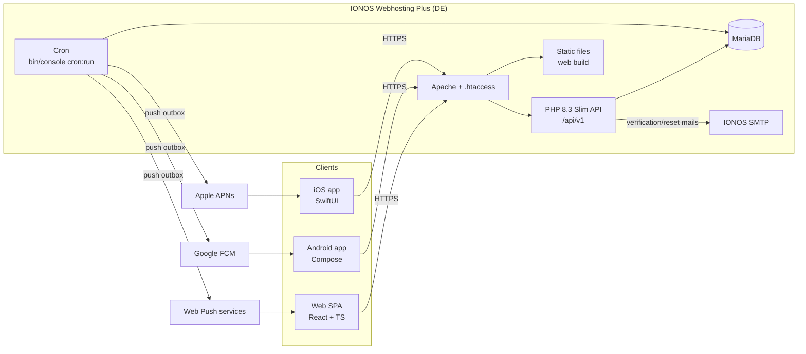
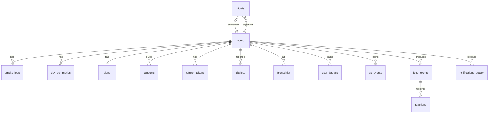
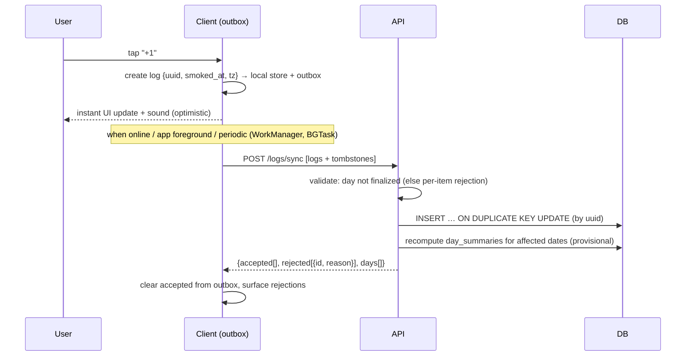
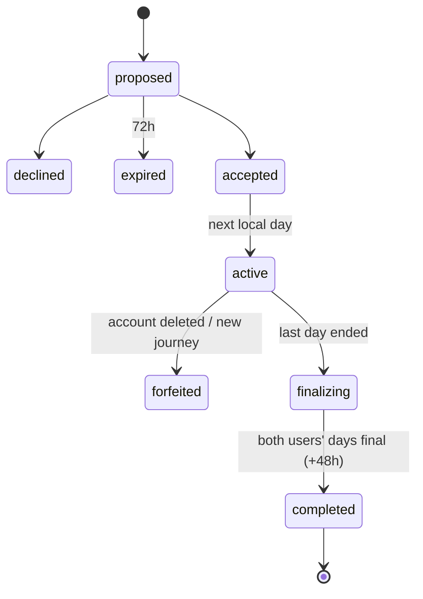

# High-Level Design (HLD)

**Project:** smoke-detector (working title)
**Status:** Draft v0.1 — 2026-11-17 — for review
**Implements:** [SRS.md](SRS.md)

---

## 1. Architecture decisions (summary)

| # | Decision | Options considered | **Chosen** | Why |
|---|---|---|---|---|
| AD-1 | Backend runtime | PHP/Slim · PHP/Laravel · Node on VPS · BaaS (Firebase/Supabase) | **PHP 8.3 + Slim 4** | Runs natively on IONOS Webhosting Plus, which most likely can't keep a Node process alive. Small, explicit and easy to unit test. |
| AD-2 | Database | MariaDB/MySQL (IONOS) · SQLite | **MariaDB/MySQL from the IONOS package** | Included, managed and backed up. Concurrent writes from many users. |
| AD-3 | Client strategy | 3 native thin clients · KMP · PWA-first · Flutter/RN | **TS web + SwiftUI + Jetpack Compose, all thin** | **All game rules run on the server**, so business logic is written and tested once, in PHP. Clients only render and queue logs. |
| AD-4 | API contract | Code-first · **Contract-first OpenAPI 3.1** | **Contract-first** | One `openapi.yaml` generates typed clients for TS, Swift and Kotlin. The backend validates against it in tests (contract tests). |
| AD-5 | Auth | Email+pw · +Apple/Google · Magic link | **Email + password, JWT access (15 min) + rotating opaque refresh token** | Self-hosted, no third parties. Refresh tokens are stored hashed, so they can be revoked. |
| AD-6 | Offline | Offline-first · online-only | **Offline-first logging via client outbox + idempotent batch sync** | NFR-03 zero log loss. Users log outdoors. |
| AD-7 | Realtime | WebSockets · SSE · **polling + push** | **Push notifications + refresh on app foreground / pull-to-refresh** | Shared hosting allows no long-lived connections (C-1). |
| AD-8 | Background work | Queue worker · **cron** | **IONOS cron → `php bin/console cron:run` every 5 min** (URL+secret fallback) | The only background mechanism available. Jobs are idempotent. |
| AD-9 | Hosting topology | API subdomain · **same origin** | **Same origin: `/` = web SPA, `/api/v1` = PHP** | No CORS, and the web refresh token can live in an httpOnly SameSite=Strict cookie. |
| AD-10 | Web framework | React · Vue · Svelte | **React 18 + Vite + TypeScript** (overridable) | Largest ecosystem for testing (Vitest, Testing Library, Playwright, MSW). |
| AD-11 | Repo & CI | **GitHub monorepo + Actions** · GitLab · manual | **GitHub monorepo** | One PR can change contract + backend + clients. macOS runners for iOS. |
| AD-12 | Delivery order | **Web → iOS → Android** | as chosen | The web client exercises the API quickly. Native clients follow against a stable contract. |

---

## 2. System context



---

## 3. Repository layout (monorepo)

```
smoke-detector/
├── api/openapi.yaml            # single source of truth for the HTTP contract
├── backend/                    # PHP 8.3, Slim 4
│   ├── public/index.php        # front controller (document root on IONOS)
│   ├── public/.htaccess
│   ├── src/Domain/             # pure PHP: scoring, streaks, XP, plan, duels — NO I/O
│   ├── src/Application/        # use cases (LogSmoke, CheckIn, CreateDuel, FinalizeDays…)
│   ├── src/Infrastructure/     # PDO repositories, mailer, push senders, clock
│   ├── src/Http/               # Slim actions, middleware, request/response mapping
│   ├── src/Cron/               # job runner + jobs
│   ├── config/rules/v1.php     # XP / badge / taper rule table (versioned, SRS App. A)
│   ├── migrations/             # Phinx migrations
│   ├── bin/console             # CLI: migrate, cron:run, …
│   └── tests/{Unit,Integration,Contract}/
├── web/                        # React + Vite + TS
├── ios/                        # Xcode project, SwiftUI
├── android/                    # Gradle, Compose
├── shared/assets/              # sounds, animations (Lottie/Rive), badge art, i18n strings source
├── docs/                       # SRS, HLD, ADRs
└── .github/workflows/
```

---

## 4. Backend design

### 4.1 Layers
- **Domain** (pure, deterministic and fully unit-tested): `ReductionPlan`, `DayScore`,
  `StreakCalculator`, `XpCalculator`, `DuelJudge`, `LeagueRanker`, `BadgeEvaluator`,
  `HealthMilestones`. Inputs are value objects plus a `RuleSet` version. Time comes in as a `LocalDate`
  or through an injected `Clock`, never `new DateTime()` inside the domain.
- **Application**: one class per use case. It orchestrates repositories and domain objects and owns the
  transaction boundaries.
- **Infrastructure**: PDO repositories, `SmtpMailer`, `ApnsSender`, `FcmSender`, `WebPushSender` and
  `SystemClock`, each behind an interface with fakes for tests.
- **HTTP**: Slim actions translate JSON ↔ commands. Errors use RFC 9457 `application/problem+json`.

### 4.2 Key libraries (all pure PHP, installed via Composer in CI, `vendor/` uploaded)
`slim/slim` 4, `php-di/php-di`, `robmorgan/phinx`, `firebase/php-jwt`, `symfony/mailer`,
`minishlink/web-push`, `league/openapi-psr7-validator` (tests), `phpunit/phpunit` 11,
`phpstan/phpstan` (max level), `friendsofphp/php-cs-fixer`, optional `infection/infection` (mutation testing).

### 4.3 Data model (core tables)



| Table | Key columns / notes |
|---|---|
| `users` | id, email (unique), password_hash, display_name, avatar_key, locale, timezone, email_verified_at, journey_id, deleted_at |
| `consents` | user_id, type (age18, art9, privacy), version, granted_at |
| `plans` | user_id, journey_id, baseline, goal_mode, target, taper_speed, start_date, rules_version |
| `smoke_logs` | **id = client UUID** (idempotency), user_id, smoked_at_utc, local_date, count, deleted (tombstone), created_at |
| `day_summaries` | user_id, local_date, count, limit, checked_in, freeze_used, status (provisional/final), xp, rules_version |
| `streaks` | user_id, type (checkin/under_limit), current, longest, freezes_held |
| `xp_events` | user_id, source, ref_id, amount, created_at — append-only ledger; XP total = sum |
| `friendships` | user_a < user_b, status (pending/accepted/blocked), requested_by |
| `duels` | id, challenger_id, opponent_id, period_days, start_date, status, winner_id, result_json |
| `league_results` | period_type, period_key (e.g. 2026-W47), user_id, reduction, rank, final |
| `user_badges` | user_id, badge_key, awarded_at |
| `feed_events` / `reactions` | event type + payload (no raw counts) / reaction_key, from_user |
| `devices` | user_id, platform (ios/android/web), push_token / web-push subscription, locale |
| `notifications_outbox` | user_id, type, payload, not_before, sent_at, attempts |
| `refresh_tokens` | user_id, token_hash, device_label, expires_at, revoked_at |
| `rate_limits` | key, window_start, hits |

### 4.4 API overview (`/api/v1`, full detail in `api/openapi.yaml`)
| Area | Endpoints |
|---|---|
| Auth | `POST /auth/register`, `/auth/verify-email`, `/auth/login`, `/auth/refresh`, `/auth/logout`, `/auth/password-reset/{request,confirm}` |
| Me | `GET/PATCH /me`, `PUT /me/plan`, `POST /me/journey` (new baseline), `GET /me/export`, `DELETE /me` |
| Logging | `POST /logs/sync` (batch upsert + tombstones → returns affected day summaries), `POST /days/{date}/check-in`, `GET /days?from&to` |
| Progress | `GET /me/dashboard` (today, limit, streaks, XP, level, next milestone), `GET /me/badges` |
| Friends | `GET /friends`, `POST /friends/requests` (by invite code), `POST /friends/requests/{id}/{accept,decline}`, `DELETE /friends/{id}`, `POST /friends/{id}/block` |
| Competition | `POST /duels`, `POST /duels/{id}/{accept,decline,cancel}`, `GET /duels`, `GET /duels/{id}`, `GET /leagues/{type}/{periodKey}`, `GET /leagues/xp/current` |
| Social | `GET /feed`, `POST /feed/{id}/reactions`, `POST /friends/{id}/nudge` |
| Devices | `PUT /devices/{id}` (push token), `DELETE /devices/{id}`, `GET/PUT /me/notification-settings` |

---

## 5. Key flows

### 5.1 Offline logging & sync (FR-LOG-02, NFR-03)


### 5.2 Day finalization & scoring (cron, every 5 min)
1. Select users whose local `date − 2 days` has passed midnight and still has provisional days.
2. For each such day: build the `DayScore` (count, limit from `ReductionPlan`, check-in), apply a freeze
   if needed, update `streaks`, append `xp_events`, evaluate badges, mark the day `final`. **One
   transaction per user-day. Idempotent**: re-running is a no-op.
3. Finalize any duels and league periods whose days are now all final → `DuelJudge` / `LeagueRanker`.
4. Write feed events + `notifications_outbox` rows.
5. Dispatch the outbox (batch ≤ 200, retries with backoff, invalid tokens pruned).
6. Housekeeping: expire duel invites (72 h), purge accounts deleted > 30 days ago, delete expired tokens.

The job runner holds a DB advisory lock (`GET_LOCK`) so overlapping cron runs never double-process.
The time budget per run is < 50 s. Leftover work is picked up in the next run.

### 5.3 Duel lifecycle


### 5.4 Reduction formula (FR-COMP-03/06)
```
counted_days   = days in window since max(window_start, journey_start)
expected       = baseline × counted_days
actual         = Σ count(day)          where day checked in
               + Σ baseline            where day NOT checked in (and no freeze)
reduction      = 1 − actual / expected
```

---

## 6. Client design (all three follow the same shape)

```
UI (screens)  →  ViewModel / state  →  Repository  →  ├─ Generated API client (from openapi.yaml)
                                                     └─ Local store + Outbox (offline logs, cached dashboard)
SoundManager / Haptics / Celebration overlay ← driven by server "events" in responses
```

| | Web | iOS | Android |
|---|---|---|---|
| UI | React 18 + Vite + TS | SwiftUI, iOS 17+ | Jetpack Compose, minSdk 26 |
| State | TanStack Query + small store | Observation (`@Observable`) | ViewModel + StateFlow |
| API client | `openapi-typescript` + `openapi-fetch` | `swift-openapi-generator` | `openapi-generator` (kotlin + ktor/okhttp) |
| Local store / outbox | IndexedDB (via `idb`) + Service Worker | SwiftData | Room |
| Background sync | on focus / online event | BGAppRefreshTask + foreground | WorkManager |
| Token storage | access in memory, refresh in httpOnly cookie | Keychain | EncryptedSharedPreferences / DataStore+Tink |
| Push | Web Push (VAPID) via Service Worker | APNs | FCM |
| i18n | i18next | String Catalogs | `strings.xml` (de/en) |
| Tests | Vitest, Testing Library, MSW, Playwright | Swift Testing / XCTest, XCUITest | JUnit 5, Turbine, Compose UI tests, Robolectric |

**Celebrations are server-driven.** Responses to sync and check-in include an `events[]` array (e.g.
`streak_extended`, `level_up`, `badge_earned`). Clients map each event to an animation and sound. Clients
never compute XP themselves, so the three platforms can't drift apart. The one exception is an
optimistic "+1 saved" sound/animation that plays locally.

Sounds and animations live in `shared/assets/`. They must be original or licensed (OQ-1).

---

## 7. Cross-cutting concerns
- **Time zones:** every day calculation uses the user's IANA time zone stored on the server. Logs
  carry UTC plus the client's offset. `local_date` is computed server-side. A time zone change applies
  from the next local day onward.
- **Security:** HTTPS + HSTS, Argon2id via `password_hash`, rate limiting in DB (`rate_limits`),
  JWT signed with HS256 using a secret from a config file **outside the document root**, input
  validation against the OpenAPI schema, prepared statements only, security headers via `.htaccess`.
- **Privacy:** aggregate-only friend views (FR-FRND-03), generic push payloads, JSON export, hard-delete
  job, no third-party analytics. Logs are kept indefinitely while the account exists (needed for 6-month
  windows) and are purged on deletion.
- **Errors & observability:** RFC 9457 problem responses. Logs go to a file outside the document root
  with daily rotation done by cron. `/api/v1/health` checks DB + cron heartbeat (last run time).
- **Configuration:** `config/local.php` (secrets, DB, SMTP, APNs key, FCM service account, VAPID keys)
  stays outside the document root, is never committed, and is uploaded once by hand.

---

## 8. Deployment (IONOS Webhosting Plus)

```
/ (SFTP home)
├── app/                       # backend (src, vendor, config, migrations, bin)
│   └── config/local.php       # secrets, uploaded manually once
├── htdocs/                    # domain document root → web build + api front controller
│   ├── index.html, assets/…   # web SPA
│   └── api/index.php          # requires ../../app/bootstrap.php
└── logs/
```

- IONOS lets you point a domain or subdomain at any folder: `app.<domain>` → `htdocs`,
  `staging.<domain>` → `staging/htdocs` (with a separate DB).
- `.htaccess`: route `/api/*` → `api/index.php`, send all other unknown paths → `index.html` (SPA),
  force HTTPS, add security headers.
- **Release:** CI builds the artifact (`composer install --no-dev -o`, `vite build`) → uploads it over SFTP
  (`lftp mirror -R` with an SSH key) to `releases/<sha>` → switches the active folder (symlink via SSH if
  allowed, otherwise a rename) → runs `php bin/console migrate` over SSH → smoke-tests `/api/v1/health`.
- Cron (IONOS cron manager): `*/5 * * * * php ~/app/bin/console cron:run`.
- Mobile apps: TestFlight / Play Internal Testing via Fastlane in CI (requires the developer accounts, OQ-4).

---

## 9. Test strategy (TDD)

**Workflow:** red → green → refactor, one SRS requirement at a time. A test's name (or tag) contains the
FR ID, e.g. `test_FR_COMP_03_missing_checkin_counts_as_baseline`. A CI script produces a
**traceability report** (FR ID → tests) and fails if a `M` requirement with logic has no test.

| Level | What | Tools | Where it runs |
|---|---|---|---|
| Domain unit | Scoring, streaks, XP, plan, duel judge, league ranker, badges — table-driven cases straight from the SRS | PHPUnit (+ Infection) | every push |
| Integration | Repositories, use cases, cron jobs against real MariaDB | PHPUnit + MariaDB service container | every push |
| Contract | Every API response validated against `openapi.yaml`. Generated clients compile. | openapi-psr7-validator, codegen in CI | every push |
| Client unit | ViewModels, outbox/sync logic, event → celebration mapping | Vitest / Swift Testing / JUnit 5 + Turbine | every push |
| Client UI | Key screens: onboarding, +1, check-in, duel | Testing Library / XCUITest / Compose UI | every push |
| E2E | Register → log offline → sync → duel → finalize (with time travel via test `Clock`) | Playwright against staging | on `main`, nightly |
| Deploy smoke | `/health`, login, sync one log | curl/Playwright script | after each deploy |
| Manual | Sounds/haptics feel, push on real devices, accessibility | checklist in `docs/` | per release |

**Time control:** the backend accepts a test-only `X-Test-Now` header (enabled only when
`APP_ENV=testing`), and cron jobs take `--now`. This lets 7-day duels be tested in seconds.

---

## 10. Build plan

| Step | Deliverable | Key decision (default) |
|---|---|---|
| 0 | **IONOS spike** (half a day): deploy a hello-world Slim app + migration + cron + outbound HTTP/2 to APNs sandbox + SMTP mail | Confirms the risks in §11 before anything else is built |
| 1 | Monorepo, CI skeleton, OpenAPI v1 draft, traceability script | GitHub Actions; contract-first |
| 2 | Domain core, TDD: plan/limits, day score, streaks + freezes, XP, levels | Rules in versioned config |
| 3 | Auth, consent, email verification, account export/delete | JWT + rotating refresh |
| 4 | Logging sync + check-in + finalization cron | Idempotent UUID upsert, 48 h grace |
| 5 | Friends, duels, leagues (week/month/quarter/half-year), XP league | Calendar-aligned leagues |
| 6 | Badges, health milestones, feed, reactions, nudges | Server-emitted `events[]` |
| 7 | Notifications outbox + APNs/FCM/Web Push senders | Cron dispatch every 5 min |
| 8 | **Web client** (complete, incl. PWA + Web Push) → staging pilot | React + Vite |
| 9 | **iOS client** → TestFlight | SwiftUI + SwiftData |
| 10 | **Android client** → Play internal testing | Compose + Room |
| 11 | Legal pages, store listings, pilot with 5–10 friends (SRS §7) | — |

---

## 11. Risks & spikes

| Risk | Impact | Mitigation / spike check |
|---|---|---|
| IONOS cron minimum interval or job count too restrictive | Slow finalization / notifications | Spike step 0. Fallback: external pinger (e.g. GitHub Actions schedule) calling `/cron?key=…` |
| PHP CLI over SSH limited (no `php` binary, no symlinks) | Migrations / atomic deploy | Fallback: token-protected migration endpoint. Folder-rename deploy |
| PHP curl without HTTP/2 → APNs unusable | No iOS push | Spike step 0. Fallback: relay APNs through FCM (FCM can deliver to iOS) |
| `minishlink/web-push` needs `gmp`/`openssl` extension | No web push | Check `phpinfo()` in spike. Web push is a "nice to have" for web |
| Max execution time / memory on shared hosting | Cron jobs cut off | Batched, resumable, idempotent jobs with a time budget |
| Baseline inflation to win competitions | Unfair duels | Locked baseline (FR-PLAN-02). Pilot data to decide on a calibration week (OQ-3) |
| Three native clients = 3× UI effort | Schedule | Thin clients, generated API clients, server-driven events. Web first validates the API |
| GDPR Art. 9 health data | Legal exposure | Consent records, minimisation, EU hosting, AV-Vertrag, export/delete from day one |
| Store review (tobacco-related content) | Rejection | Frame as a reduction/quit aid, 18+ rating, no promotion of smoking |
